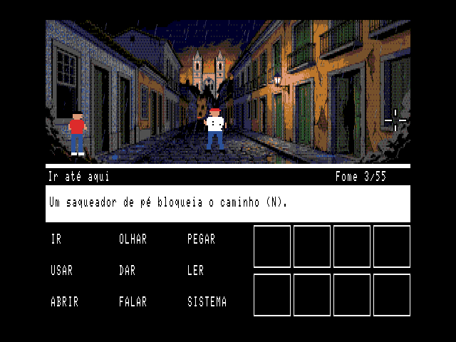
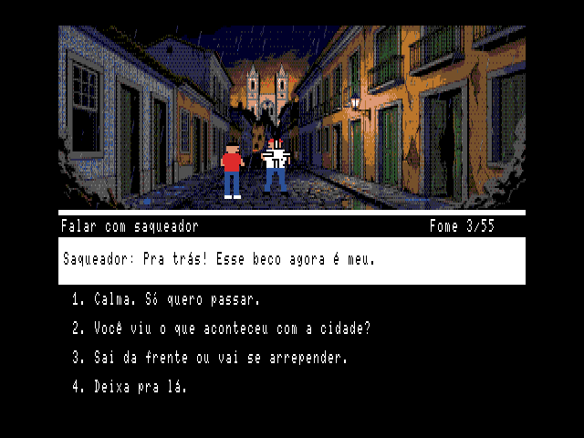
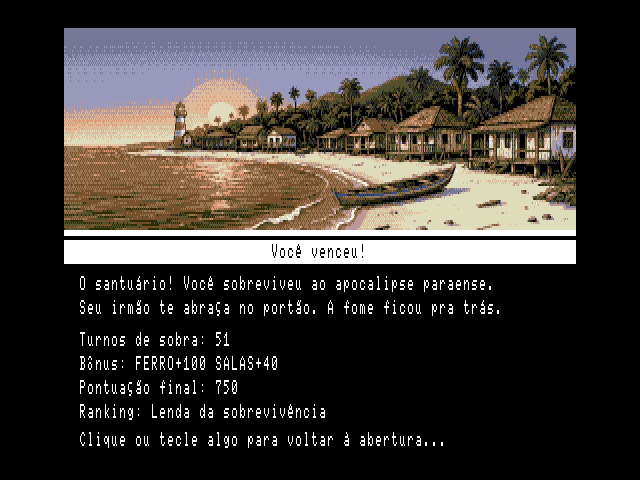
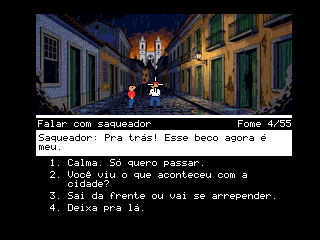

# COLHEITA ZERO — versão point-and-click (MSX2)

*O dia em que o açaí acabou* — Ver-o-Byte Studios, Belém do Pará.

Versão em teste do adventure no estilo dos jogos de verbos: aponte, clique, converse.
Um vírus destruiu as colheitas; atravesse Belém e chegue à Ilha do Mosqueiro antes que a fome chegue até você.

## Jogar no navegador (WebMSX)

**[Clique aqui para jogar](https://webmsx.org/?MACHINE=MSX2E&MOUSE_MODE=1&ROM=https://raw.githubusercontent.com/passaroii/colheita-zero-pc/main/COLHEITA_ZERO_PC.rom&DISK=https://raw.githubusercontent.com/passaroii/colheita-zero-pc/main/CZ_SAVE.DSK)**

Na abertura, tecla **1** = Sobrevivência (com fome e pontos) ou **2** = Exploração.
Enquanto você escolhe, toca o tema da abertura, um lundu original: com o chip FM (MSX-MUSIC ou FM-PAC, que o
WebMSX já liga sozinho) ou, sem ele, no som padrão do MSX.

| Controle | Mover o cursor | Clicar | Cancelar |
|---|---|---|---|
| Teclado | setas | ENTER ou ESPAÇO | ESC |
| Joystick (porta 2) | alavanca | botão A | botão B |
| Mouse (porta 1) | mouse | botão esquerdo | botão direito |

- Escolha um verbo e clique na cena. Sem verbo, o clique olha as coisas e anda pelas saídas.
- **USAR / DAR:** o verbo, o item da mochila e depois onde ou para quem.
- Atalhos: **I O P U D L A F S** = Ir, Olhar, Pegar, Usar, Dar, Ler, Abrir, Falar, Sistema; **1 a 8** = itens.
- **SISTEMA:** salvar (no disquete do link e por senha), carregar, senha, ajuda, sair.

## Edição MSX2+ (novidade)

**[Clique aqui para jogar a edição MSX2+](https://webmsx.org/?MACHINE=MSX2PE&MOUSE_MODE=1&ROM=https://raw.githubusercontent.com/passaroii/colheita-zero-pc/main/COLHEITA_ZERO_PC_2MAIS.rom&DISK=https://raw.githubusercontent.com/passaroii/colheita-zero-pc/main/CZ_SAVE.DSK)**

O mesmo jogo, com o que o MSX2+ tem a mais:

- **Cenas com milhares de cores** (modo YJK do V9958): degradês no céu, no fogo e nas paredes, sem pontilhado.
- **Letra própria e estreita**, com todos os acentos dentro do cartucho (a maioria dos MSX2+ é japonesa e não tem á, ç, ã).
  Cabem 42 letras por linha.
- **Personagem desenhado como imagem** (novo): no estilo das cenas, de perfil, de frente e de costas, andando
  com 8 quadros. O tamanho segue a perspectiva de cada sala: ele diminui quando vai para o fundo.

Precisa de um MSX2+. Num MSX2 o cartucho avisa e para: lá, use `COLHEITA_ZERO_PC.rom`.

## Arquivos

- `COLHEITA_ZERO_PC.rom` — cartucho MegaROM ASCII8 de 384 KB para MSX2.
- `COLHEITA_ZERO_PC_2MAIS.rom` — edição MSX2+, MegaROM ASCII8 de 512 KB.
- `CZ_SAVE.DSK` — disquete vazio para salvar a partida (serve para as duas edições).

