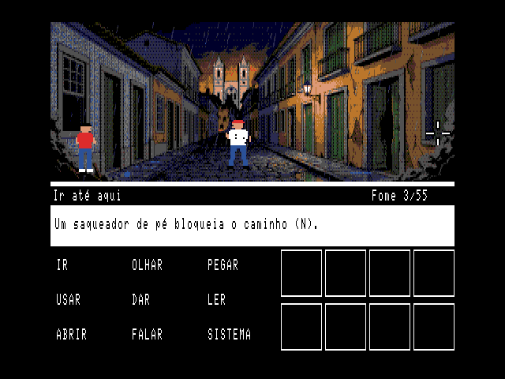
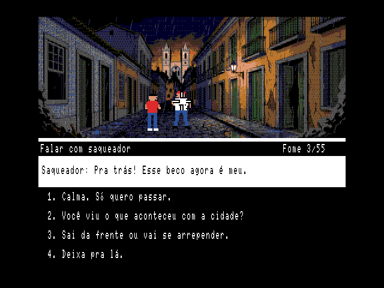
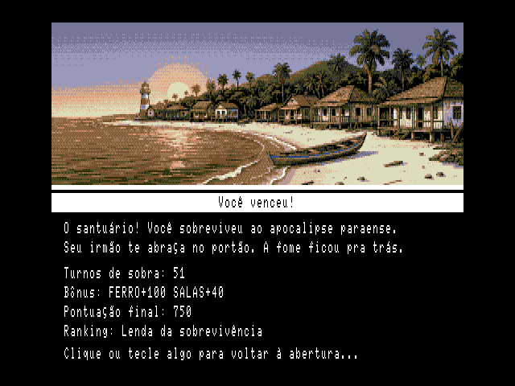

# COLHEITA ZERO — versão point-and-click (MSX2)

*O dia em que o açaí acabou* — Ver-o-Byte Studios, Belém do Pará.

Versão em teste do adventure no estilo dos jogos de verbos: aponte, clique, converse.
Um vírus destruiu as colheitas; atravesse Belém e chegue à Ilha do Mosqueiro antes que a fome chegue até você.

## Jogar no navegador (WebMSX)

**[Clique aqui para jogar](https://webmsx.org/?MACHINE=MSX2E&ROM=https://raw.githubusercontent.com/passaroii/colheita-zero-pc/main/COLHEITA_ZERO_PC.rom&DISK=https://raw.githubusercontent.com/passaroii/colheita-zero-pc/main/CZ_SAVE.DSK)**

Na abertura, tecla **1** = Sobrevivência (com fome e pontos) ou **2** = Exploração.

| Controle | Mover o cursor | Clicar | Cancelar |
|---|---|---|---|
| Teclado | setas | ENTER ou ESPAÇO | ESC |
| Joystick (porta 2) | alavanca | botão A | botão B |
| Mouse (porta 1) | mouse | botão esquerdo | botão direito |

- Escolha um verbo e clique na cena. Sem verbo, o clique olha as coisas e anda pelas saídas.
- **USAR / DAR:** o verbo, o item da mochila e depois onde ou para quem.
- Atalhos: **I O P U D L A F S** = Ir, Olhar, Pegar, Usar, Dar, Ler, Abrir, Falar, Sistema; **1 a 8** = itens.
- **SISTEMA:** salvar (no disquete do link e por senha), carregar, senha, ajuda, sair.

## Arquivos

- `COLHEITA_ZERO_PC.rom` — cartucho MegaROM ASCII8 de 384 KB para MSX2.
- `CZ_SAVE.DSK` — disquete vazio para salvar a partida.

